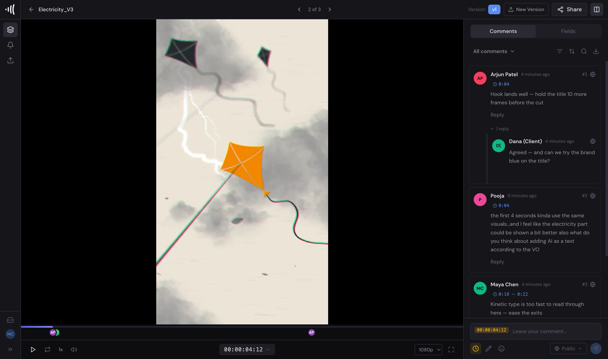
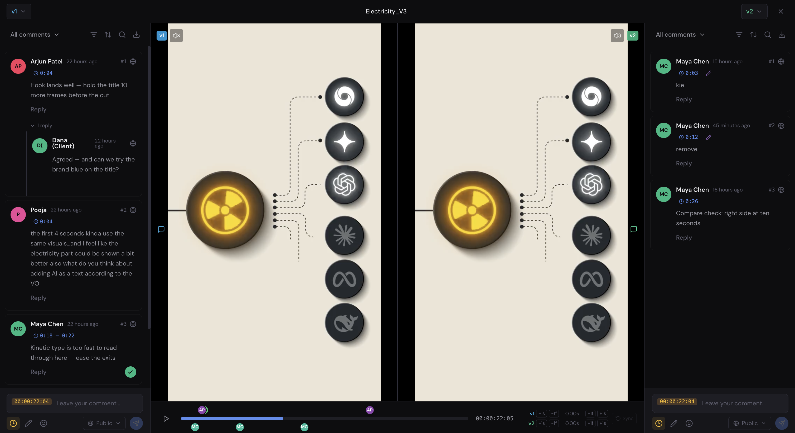
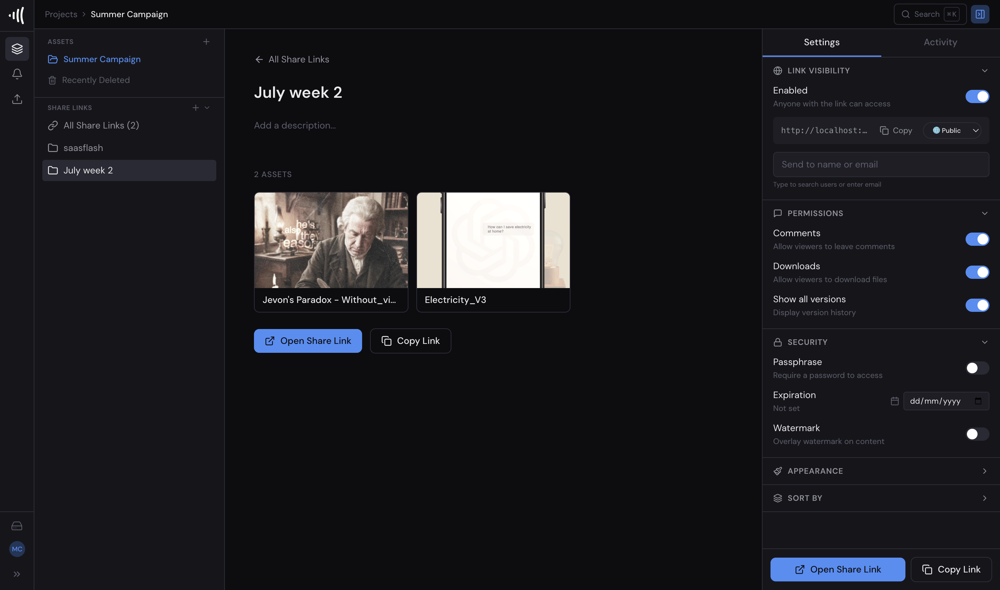

# Creative Flo

Created by Byram Smith Jr. · A DigitalFlo product · https://mydigitalflo.io

Creative Flo is a place to review your videos and have an AI agent edit them for you. You watch a video,
leave notes at the exact second something needs to change, and the agent makes the changes and uploads a new
version. It runs on your own computer or server, so your videos stay with you.

It is for creators, small teams and video editors who want an editing helper that works from plain notes,
not from a complicated editing program.



---

## What you can do with it

- **Upload** videos, images and audio into projects and folders.
- **Review** them in the browser, frame by frame.
- **Leave timecoded comments.** Each note is pinned to a moment in the video. You can also draw on a frame.
- **Keep versions.** Every new edit is saved as v2, v3 and so on. Nothing is overwritten.
- **Compare versions** side by side, or with a wipe slider, to see what changed.
- **Share links** with clients. They can watch and comment without an account. You can add a passphrase and an
  expiry date.
- **Let the AI agent edit from your comments.** Claude Code reads your notes, re-edits the video, uploads a new
  version and replies to each note.
- **Set an editing style** (captions, colours, pacing, motion graphics) so every edit has the same look.
- **Plan and record.** Write ideas and scripts in **Ideas & Scripts**, then read them from a teleprompter while
  you record in **Shoot**. Takes are saved straight into your project.

---

## How the feedback loop works

This is the heart of Creative Flo. In plain words:

1. **You comment.** Open a video and leave notes at the right moments. For example: "cut the um at 0:42".
2. **You ask the agent to look.** Click **Have Flo check now** on the video. Or click **Review all now** in a
   folder named "Review" to queue every video in it.
3. **The agent picks up the notes.** Claude Code, running on your computer, asks Creative Flo for videos with
   new notes. It takes one video at a time, so two agents never edit the same video.
4. **The agent re-edits.** It downloads the video and your open notes. It uses the editing engine in `engine/`
   to make only the changes you asked for, in your editing style.
5. **The agent checks its work.** It runs the engine's checks and watches and listens to the finished video,
   especially around each cut.
6. **The agent uploads v2.** The new edit appears as the next version of the same video.
7. **The agent replies and resolves.** Under each of your notes it writes a short reply saying what it changed,
   then marks the note as resolved.
8. **You approve.** You watch the new version and approve it, or leave more notes and repeat. The agent never
   approves for you.

Good to know:

- The agent only runs while Claude Code is running and you have asked it to check. Nothing happens in the
  background on its own.
- If you ask the agent to check for any new notes (not just the ones you queued), it waits until a video's notes
  have been quiet for about 10 minutes. That way it does not start while you are still typing.
- Only notes from signed-in team members count. Comments from guests on a share link are not sent to the agent.
- Your original footage is never changed. Every edit is a new version.

The full instructions the agent follows are in [`flo/skills/creative-flo/SKILL.md`](flo/skills/creative-flo/SKILL.md).



---

## What you need before starting

- **A computer or a cloud server.** A Mac or Linux machine works. A small cloud server works too, if you want
  others to reach it over the internet. Give it room for your videos.
- **Docker**, which runs the review app for you. Get [Docker Desktop](https://docs.docker.com/get-docker/) or
  [Docker Engine](https://docs.docker.com/engine/install/) on a server.
- **Git**, to download the code: [git-scm.com](https://git-scm.com/downloads).
- **An email account that can send mail (SMTP).** Creative Flo signs people in with emailed codes and sends
  invites by email. Most email providers give you SMTP settings.
- **For the AI agent:**
  - A Claude subscription with [Claude Code](https://docs.anthropic.com/en/docs/claude-code/overview) installed.
  - [Node.js 22 or newer](https://nodejs.org/).
  - [FFmpeg](https://ffmpeg.org/download.html), which the engine uses to cut video and audio.
- **Optional:** an [ElevenLabs](https://elevenlabs.io/) API key. It gives the agent accurate word timings
  (transcription), which makes cuts and captions more precise.

---

## Setup

Run these commands in a terminal. Each step says what it does.

1. **Get the code.** Download this repository and open its folder.

   ```sh
   git clone https://github.com/BillionaireByram/creative-flo-community.git creative-flo
   cd creative-flo
   ```

2. **Make your settings file.** This copies the example settings into `.env`, your private settings file.

   ```sh
   cp .env.example .env
   ```

3. **Fill in your email settings.** Open `.env` in a text editor. Set `MAIL_PROVIDER=smtp`, `SMTP_HOST`,
   `SMTP_USER` and `SMTP_PASSWORD` from your email provider. Set `JWT_SECRET` to a long random string.

4. **Check the settings.** This prints the full configuration. If it shows an error, fix `.env` first.

   ```sh
   docker compose -f docker-compose.dev.yml config
   ```

5. **Start Creative Flo.** The first run downloads and builds everything, so it takes a while.

   ```sh
   docker compose -f docker-compose.dev.yml up --build
   ```

6. **Create your admin account.** Open [http://localhost:3000](http://localhost:3000). The first account you
   create becomes the admin.

7. **Install the editing engine.** Open a second terminal in the `creative-flo` folder. These commands install
   the engine, check that Node and FFmpeg are found, and run its tests.

   ```sh
   cd engine
   npm ci
   npm run setup
   npm test
   npm run check
   ```

8. **Add your transcription key (optional).** `npm run setup` creates `engine/.env`. Put your ElevenLabs key
   after `ELEVENLABS_API_KEY=` in that file.

The exact commands this edition was tested with are in [`docs/SETUP-NOTES.md`](docs/SETUP-NOTES.md). To run it
on a server with a real domain and HTTPS, follow [`docs/deployment.md`](docs/deployment.md).

### Set up the agent's account

The agent signs in to Creative Flo like a person. Give it its own account.

1. **Invite the agent.** In Creative Flo, go to **Settings → Admin** and invite an email address you can read,
   for example `you+agent@example.com`. Open the invite email and set a strong password.
2. **Tell Creative Flo it is the agent.** In `.env`, set `CF_AGENT_EMAILS` to that address. Then restart so the
   change takes effect:

   ```sh
   docker compose -f docker-compose.dev.yml up -d
   ```

3. **Add the agent to your project.** Create a project, then add the agent's email as a project member.

4. **Link the project to a brand.** A brand is a short name for your look, like `my-channel` (lowercase letters,
   numbers, `-` and `_`). Only the admin can do this, and there is no button for it yet, so it is done with two
   commands. Your project ID is the long code in the address bar when the project is open
   (`/projects/<project-id>`).

   ```sh
   # Sign in as the admin and copy the "access_token" from the reply
   curl -s -X POST http://localhost:8000/auth/login \
     -H 'Content-Type: application/json' \
     -d '{"email": "you@example.com", "password": "your-admin-password"}'

   # Link the project to the brand
   curl -s -X PUT http://localhost:8000/cf/projects/<project-id>/brand \
     -H 'Authorization: Bearer <access_token>' \
     -H 'Content-Type: application/json' \
     -d '{"brand": "my-channel"}'
   ```

   You can do the same from the API page at [http://localhost:8000/docs](http://localhost:8000/docs).

5. **Give Claude Code the agent's details.** In the terminal where you will run Claude Code, set these. Use your
   own values. Do not put them in any file you share.

   ```sh
   export CREATIVE_FLO_URL=http://localhost:8000
   export CREATIVE_FLO_AGENT_EMAIL=you+agent@example.com
   export CREATIVE_FLO_AGENT_PASSWORD='the-agent-password'
   export CREATIVE_FLO_BRAND=my-channel
   ```

   `CREATIVE_FLO_URL` is where the agent reaches the Creative Flo API. On your own computer that is
   `http://localhost:8000`. On a server set up with [`docs/deployment.md`](docs/deployment.md), it is your
   address followed by `/api`, such as `https://review.example.com/api`.

---

## Your first video

1. **Upload.** Open your project and drag a short video into it. Wait until it says it is ready. Short clips
   (under two minutes) are best for a first try.
2. **Watch and comment.** Press play. When something needs to change, pause and type a note. It is pinned to
   that moment.
3. **Queue it.** Click **Have Flo check now**. The button changes to "Flo is on it".
4. **Start the agent.** In your second terminal (with the `export` lines from above), start Claude Code in the
   engine folder:

   ```sh
   cd engine
   claude
   ```

   Then type: *"Check Creative Flo for feedback and follow ../flo/skills/creative-flo/SKILL.md."*
5. **Watch it work.** Claude Code tells you what it is doing. Editing, checking and uploading can take several
   minutes.
6. **Review v2.** Refresh the video in Creative Flo. You will see v2, a reply under each note, and the notes
   marked resolved. Use compare to see v1 and v2 side by side.
7. **Approve or repeat.** Happy? Approve it. Not yet? Leave new notes on v2 and go back to step 3.

---

## Working with the agent

### Comments that work well

Say what to change and where. One change per comment is easiest.

- "Cut the um at 0:42."
- "Make the captions bigger."
- "Music too loud at 1:10."
- "Remove the pause between 0:15 and 0:18."
- "Put my name on screen when I first appear."
- "End on the logo, not on my face."

Tips:

- Pause on the exact moment before you type. The note gets that time.
- Draw on the frame when the note is about a place on screen, like "move this text here".
- Avoid vague notes like "make it better". The agent only changes what you ask for.
- The agent will not invent footage, numbers, logos or claims. If you want something on screen, say exactly what.

### Set an editing style

An editing style tells the agent how your videos should look and feel: captions, fonts, colours, pacing and
motion graphics. Set it once and every edit follows it.

- **In the app:** open **Style** in the sidebar. Answer the short style interview and approve the result. Until
  you do, your project shows a reminder: "Set up your editing style so Flo edits in your look".
- **In the engine:** inside `engine/`, ask Claude Code to run the `style-interview` skill.

Ready-made starting points are in [`engine/styles/templates/`](engine/styles/templates/) and
[`engine/styles/house/`](engine/styles/house/). A complete example brand is in
[`engine/styles/clients/example-ember-coffee/`](engine/styles/clients/example-ember-coffee/).

---

## Troubleshooting

**The page at localhost:3000 does not open.**
The first build takes several minutes. Watch the terminal from setup step 5. If it says a port is already in
use, another program is using port 3000, 8000, 9000, 9001, 5433 or 6379. Close it and start again.

**No sign-in code or invite email arrives.**
Check the SMTP settings in `.env`, then restart with `docker compose -f docker-compose.dev.yml up -d`. To see
email errors, run `docker compose -f docker-compose.dev.yml logs email_worker`.

**A video stays "processing".**
Look at the video worker with `docker compose -f docker-compose.dev.yml logs worker`. If you changed code or
settings, restart the workers:
`docker compose -f docker-compose.dev.yml restart worker email_worker maintenance_worker beat`.

**"Have Flo check now" is greyed out and says "Leave a comment first".**
There are no open notes from a signed-in team member on this video. Guest comments from share links do not
count. Resolved notes do not count either.

**The agent says "Project has no brand" or finds nothing to do.**
Link the project to a brand (see "Set up the agent's account", step 4). Make sure `CREATIVE_FLO_BRAND` matches
that brand exactly. Make sure the agent's account is a member of the project.

**The agent gets "permission denied" or "forbidden".**
The agent's email must be in `CF_AGENT_EMAILS` in `.env`, and you must restart after changing it. Check the
email and password in your `export` lines too.

**`npm run setup` says ffmpeg is missing or Node 22+ is required.**
Install FFmpeg and Node.js 22 or newer (links above), open a new terminal, and run it again.

**Test videos disappear from my local copy.**
The local version cleans up on a schedule: unfinished uploads after 24 hours, and deleted items after 30 days.
To switch this off while testing, set `STALE_UPLOAD_TIMEOUT_HOURS=0` and `SOFT_DELETE_RETENTION_DAYS=0` in
`.env` and restart.

---

## Security notes

- **Keep `.env` private.** It holds your passwords and keys. Never share it and never commit it to git. The same
  goes for `engine/.env` and your `CREATIVE_FLO_*` values.
- **Never commit keys.** If a key ends up somewhere public, cancel it with the provider and make a new one.
- **Change the default passwords before going online.** `.env.example` ships with simple values such as
  `JWT_SECRET=change-me-to-a-secure-random-string`, `POSTGRES_PASSWORD=freeframe` and `S3_SECRET_KEY=minioadmin`.
  They are fine on your own computer, not on a server. [`docs/deployment.md`](docs/deployment.md) explains the
  production setup.
- **Use expiring share links.** Give each share link an expiry date, and a passphrase for anything private. You
  can turn off downloads and add a watermark.
- **Give the agent its own account.** Add it only to the projects it should edit.
- **Comments are instructions, not commands.** The agent treats notes as editing requests and never runs them
  as computer commands. Still, only invite people you trust to comment.



---

## Credits and license

**About the creator:** Creative Flo was created by Byram Smith Jr. A DigitalFlo product.
Website: [mydigitalflo.io](https://mydigitalflo.io).

Creative Flo is built on the work of others:

- [FreeFrame](https://github.com/Techiebutler/freeframe) by Techiebutler, the review app this is based on.
- The original edit-engine kit by Nate Herk, which became `engine/`.
- [HyperFrames](https://github.com/heygen-com/hyperframes) and [GSAP](https://gsap.com/), used for motion
  graphics.

Creative Flo is released under the MIT License. See [LICENSE](LICENSE), [engine/LICENSE](engine/LICENSE) and
[NOTICE](NOTICE). Any copy or derivative must keep LICENSE and NOTICE intact.
Third-party licenses are listed in [engine/THIRD_PARTY_NOTICES.md](engine/THIRD_PARTY_NOTICES.md) and
[engine/licenses/](engine/licenses/); their own terms apply.

Copyright (c) 2026 Byram Smith Jr. / DigitalFlo (Creative Flo).
Copyright (c) 2026 Creative Flo contributors. Upstream copyright notices are kept in their license files.
